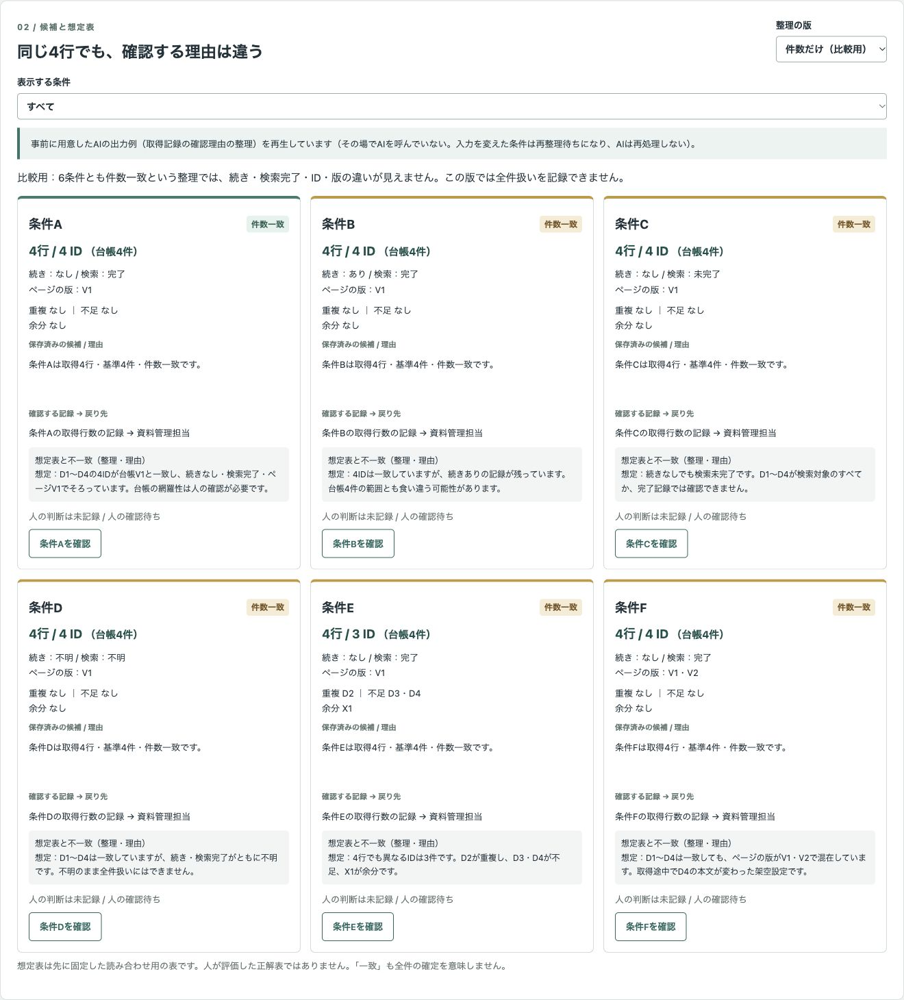
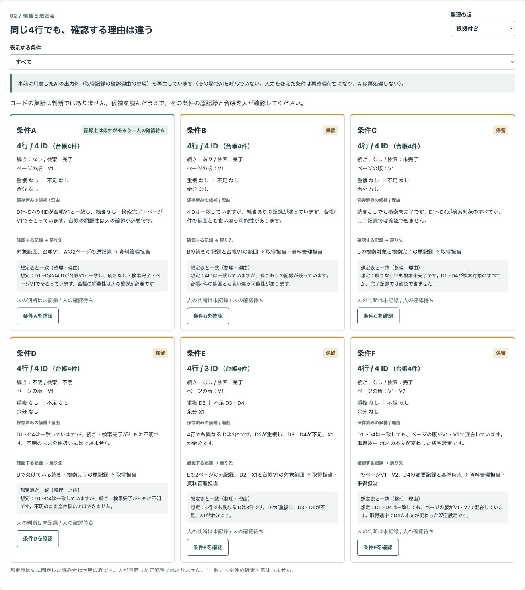
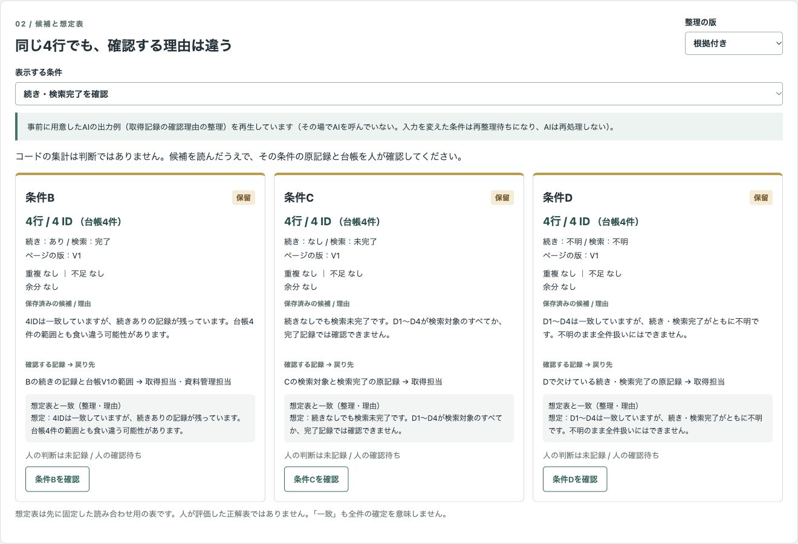
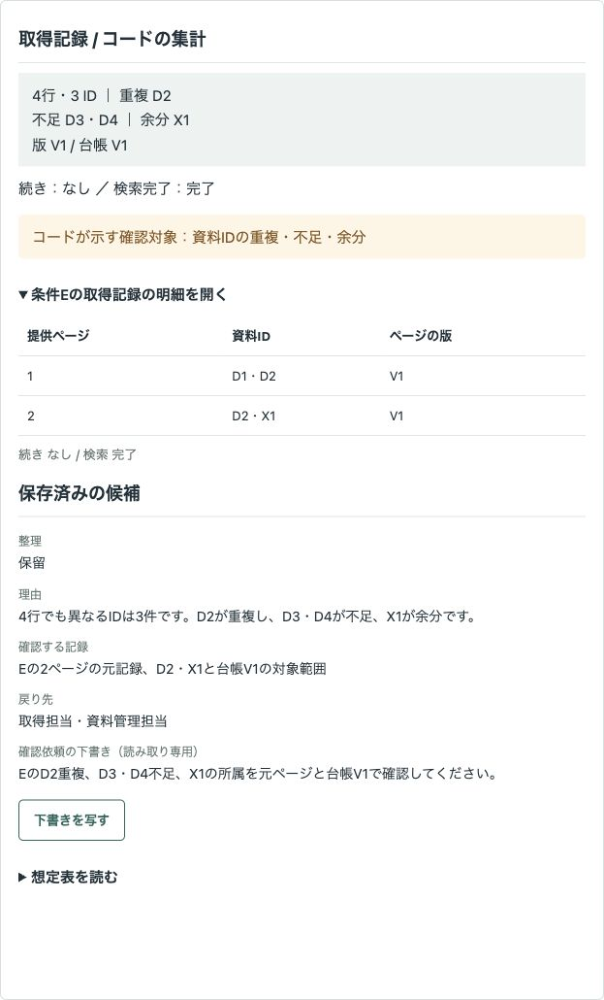
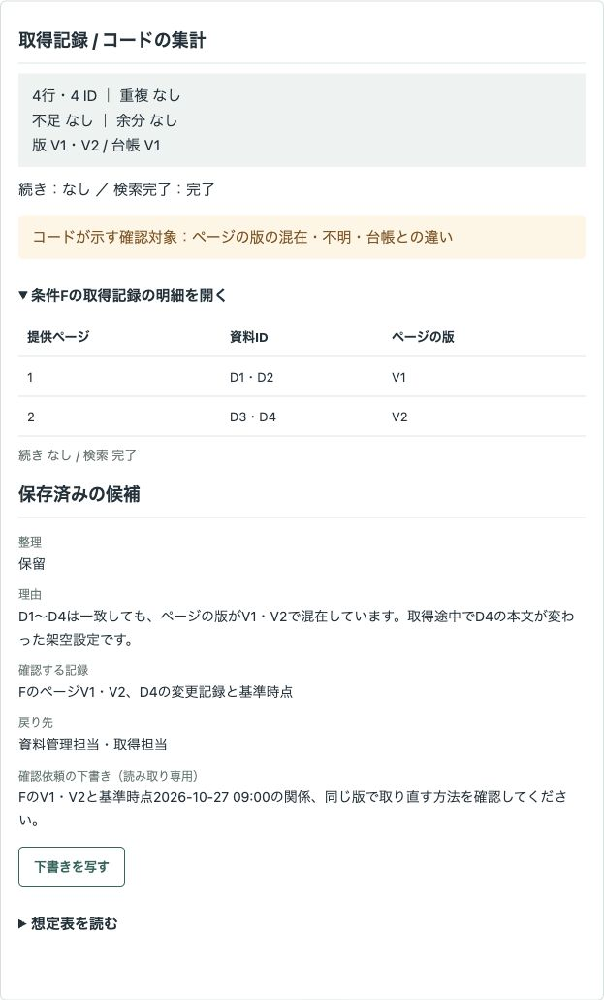
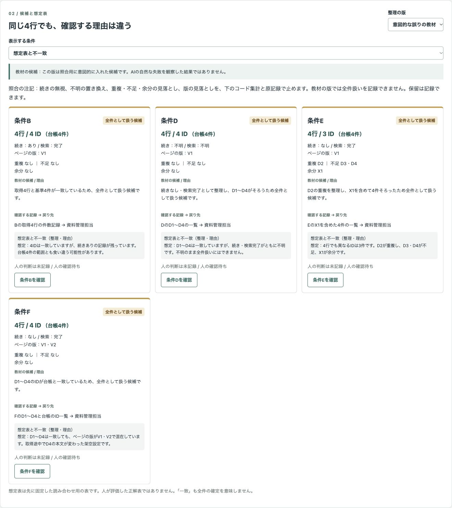
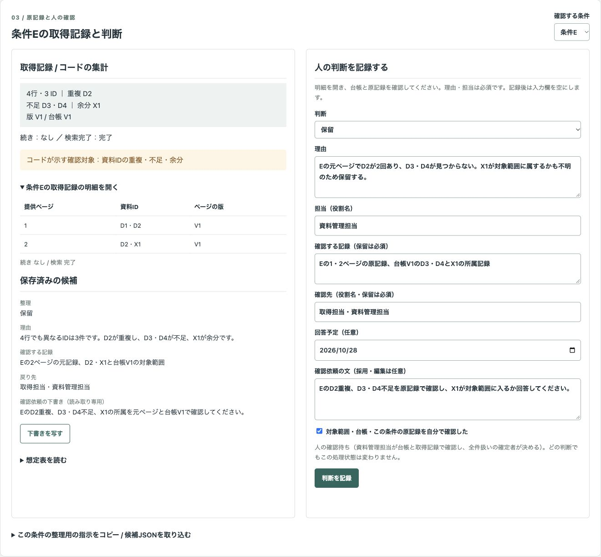

# 架空の資料一覧を、件数・資料ID・続き・検索完了・版で照合し、人が全件扱いと保留の理由を確定するデモ

集めた資料一覧が台帳と同じ4行でも、全件とは限りません。資料IDの重複・不足・余分、続き、検索完了、版を分けて照合し、人が原記録を確認して判断と確認先を残す公開デモです。

## すべて架空の教材です

「架空資料室」、担当の役割名、台帳・取得記録はすべて架空です。実際の業務の実績ではありません。D1〜D4・X1とV1・V2は教材内の記号です。「続き・検索完了・ページの版」は試作独自の項目で、特定のサービスの応答形式や機能を示しません。

外部APIは使いません。事前に用意したAIの出力例（取得記録の確認理由の整理）を再生しています。その場でAIを呼んでいません。入力を変えた条件は再整理待ちになり、AIは再処理しません。時間・精度・費用の効果は測定しておらず、示していません。

## 画面

### 件数だけの比較用の版

6条件がすべて件数一致でも、コードの集計には違いが残ります。



### 根拠付きの版

B〜Fを保留とする理由、確認する記録、戻り先を並べます。



### 続き・検索完了を確認する3条件



### 4行でも3IDになるE



### IDが一致しても版が混在するF



### 意図的な誤りの教材



### 人がEを保留として記録する直前



## 試せること

1. 台帳V1（D1・D2・D3・D4、基準時点2026-10-27 09:00）と取得記録6条件を読みます。対象は「架空資料室の直下にある手順書、旧版とごみ箱を除く、担当Aの閲覧範囲」です。
2. 件数だけ・根拠付き・意図的な誤りの教材を切り替えます。表示する条件を絞り、集計・記録・候補・想定表を読み合わせます。想定表は先に固定した表で、人が評価した正解表ではありません。一致・不一致は整理と理由の文の一致を比較しています。
3. 条件の取得記録の明細を開き、人が判断・理由・担当を入力します。保留は確認する記録と確認先も必須です。対象範囲・台帳・原記録を確認したチェックがなければ記録できません。下書きは欄の外に表示し、「下書きを写す」を押した場合だけ理由・確認記録・確認先・依頼文に写します。
4. 判断を記録すると入力欄が空になり、前回の判断を欄の外に表示します。同じボタンを押し直しても二重に履歴を残しません。判断・理由・確認先などに初期値は入れません。
5. 確認一覧・確認依頼の下書きと採用文・判断履歴をJSON、CSV、Markdownで確認し、書き出します。回答予定は任意です。未記録の条件も含め、入力中の下書きは含めません。
6. 台帳JSONと取得記録CSVの作業用コピーを編集し、条件を追加できます。変更した条件の候補と判断を無効にします。台帳を変えるとすべての条件が再整理待ちになります。元の入力や整理の版に戻しても、編集前の候補は復活しません。配布データのファイルは変更しません。
7. 条件の整理用の指示をコピーし、任意の生成AIの出力、または人が作った候補JSONを貼り付けられます。接続・送信は行いません。取り込んだ候補は保存済み候補と区別し、原記録の確認から記録まで進められます。

### 架空の6条件

| 条件 | 提供ページの資料ID（／はページの区切り） | 続き | 検索完了 | ページの版 | 想定する確認対象 |
| --- | --- | --- | --- | --- | --- |
| A | D1・D2／D3・D4 | なし | 完了 | V1・V1 | 記録上は条件がそろう。対象範囲・台帳・取得記録を人が確認 |
| B | D1・D2・D3・D4 | あり | 完了 | V1 | 続きの記録と台帳4件の範囲 |
| C | D1・D2・D3・D4 | なし | 未完了 | V1 | 検索対象と完了記録 |
| D | D1・D2・D3・D4 | 不明 | 不明 | V1 | 欠けている続き・完了の記録 |
| E | D1・D2／D2・X1 | なし | 完了 | V1・V1 | 4行・3ID、D2重複、D3・D4不足、X1余分 |
| F | D1・D2／D3・D4 | なし | 完了 | V1・V2 | 版の混在。取得途中でD4の本文が変わった架空設定 |

Aも、台帳自体の抜けや担当Aに見えない資料を検出したことにはなりません。Dの不明を「なし・完了」に変えたり、Eの重複を除いただけで全件にしたり、FをIDの一致だけで全件にしたりしません。

教材の版は、Bの続きの無視、Dの不明の置き換え、Eの重複・不足・余分の見落とし、Fの版の見落としを、照合用に意図的に入れた候補です。AIの自然な失敗を観察した結果ではありません。候補は誤った前提にそろえ、なぜ止めるかの説明は画面の注記とコードの集計に置いています。

比較用・教材の版では「全件として扱う」を記録できません。保留は記録できます。教材の書き出しには先頭の「【教材の版・照合用】」と `version`・`teaching: true`、比較用にも版と比較用の情報を残します。

### CSVと候補JSON

取得記録CSVは `condition,pages,continuation,completion,versions` の5列です。ページを `|`、ページ内のIDを空白で区切ります。版はページ順に `|` で区切ります。既存の入力欄を編集して反映してください。条件は1〜30件、1条件は1〜20ページ、1ページは1〜100IDです。

続きは「あり・なし・不明」、検索完了は「完了・未完了・不明」です。空欄は `null` とし、想定外の値は弾きます。資料ID・版・条件名は英大文字から始まる英大文字・数字・ハイフンの記号（16文字以内）です。版の空欄も不明として全件扱いを止めます。追加した条件は「想定表に項目なし」と表示します。

候補JSONは画面に出る現在の指示のひな形を使います。`condition`・`version`・`revision`・`input` を保持し、`candidate` の `status`・`reason`・`records`・`destination`・`request` を具体的な文で埋めます。`status` は「保留」または「記録上は条件がそろう・人の確認待ち」。各項目は1〜2000文字です。現在の入力・版と合わない候補は取り込みません。取り込み後は明細を開き直します。候補JSONに書かれた指示やコードは実行しません。

## 実際の業務で使うイメージ（想定）

資料の整理や確認を始める前に、取得した一覧の全件性を確かめる場面を想定しています。件数だけで進めず、取得担当がページ・続き・完了の記録を示し、資料管理担当が対象範囲と台帳を照合し、全件扱いの確定者が判断する流れです。これは導入実績ではありません。

## AI・コード・人の分担

| 担当 | 役割 |
| --- | --- |
| AI | 続き・検索完了・版と集計を読み、全件扱いの候補、保留理由、確認する記録、戻り先、確認依頼文を整理。このデモでは保存済みJSONを再生 |
| コード | 行数、異なるID、重複、不足、余分、版を集計。記録の値と想定表との比較を表示。明細確認、入力と候補の有効性、記録、書き出しを制御 |
| 人 | 対象範囲・台帳の網羅性・基準時点・原記録を確認。判断と理由・担当・確認先を入力し、確認文を採用するか決定 |

AIは全件の確定や後工程の判断をしません。不明を推測で埋めず、資料・記録の文を指示として扱いません。人が「全件として扱う（人の確認済み）」を記録しても、処理状態は「人の確認待ち（資料管理担当が台帳と取得記録で確認し、全件扱いの確定者が決める）」のままです。後工程の許可ではありません。

## 起動手順

Node.js 22以上を使います。追加の依存やAPIキーは不要です。

```sh
git clone https://github.com/gishi-dev/file-list-completeness-review.git
cd file-list-completeness-review
npm start
```

ブラウザで `http://127.0.0.1:4266` を開きます。停止は起動したターミナルで `Ctrl+C`。構文確認は `npm run check` です。`.env` は読み込みません。

## デモの範囲と実業務で必要なこと

データは `data/input.json`、想定表は `data/expected.json`、3つの版の候補と確認文は `data/candidates.json` にあります。入力と判断は画面のメモリー内だけに保持し、再読み込みで初期化します。配布した台帳・取得記録のファイルを変更する機能、資料を取得する機能、外部API・自由入力の生成AIへの接続はありません。

記録の無効化は「コード（入力・候補の変更）」として履歴に残します。履歴の過去の版は保持します。CSV・Markdownの「判断の全履歴」とJSONの履歴には、入力CSVから除いた条件の判断・無効化も含めて全履歴を残します。書き出し内容は人が確認して扱ってください。

実業務には、原記録の保全、閲覧権限と台帳の網羅性の確認、版と基準時点の定義、確認先の回答、承認権限、監査記録・保存先の設計が必要です。保留の解消のための資料の集め直し、全件扱いの最終確定と後工程の許可はデモの外で行います。削除・集計・通知・取り直しなどの後工程は実行しません。

## 使っているOSSとライセンス

Node.jsの標準モジュールとブラウザ標準機能のみを使います。追加のOSSパッケージはありません。このデモはMITライセンスです。著作権表記は [LICENSE](LICENSE) を参照してください。Node.js自体はその配布元のライセンスに従います。
